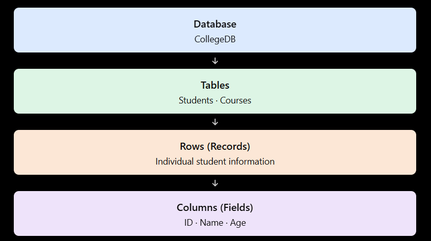
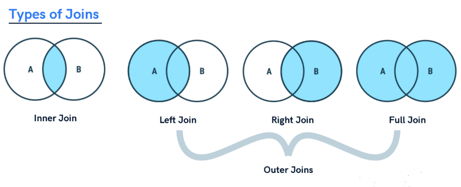
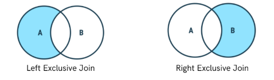
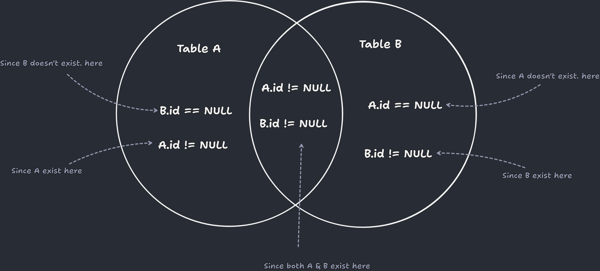

# Structured Query Language (SQL)

---
# Content
1. [introduction](#introduction)
2. [Database in SQL](#database-in-sql)
3. [DataType in SQL](#datatype-in-sql)
4. [Types of SQL Commands](#types-of-sql-commands)
5. [Database-Related SQL Queries](#database-related-sql-queries)
6. [Table-Related SQL Queries](#table-related-sql-queries)
    - [INSERT INTO - Adding Data Into a Table ](#insert-into---adding-data-into-a-table)
    - [SELECT - Reading Data From a Table](#select---reading-data-from-a-table)
    - [UPDATE - Updating Data in a Table](#update---updating-data-in-a-table)
    - [ALTER - Modifying the Structure of a Table](#alter---modifying-the-structure-of-a-table)
    - [ DELETE - Deleting Data from a Table](#delete---deleting-data-from-a-table)
    - [TRUNCATE - Removing All Records from a Table](#truncate---removing-all-records-from-a-table)
7. [Operators in SQL](#operators-in-sql)
8. [Aggregate Functions in SQL](#aggregate-functions-in-sql)
9. [GROUP BY / HAVING](#group-by--having)
10. [JOIN in SQL](#join-in-sql)

---
# Introduction
SQL (Structured Query Language) is a standard programming language used to create, store, retrieve, update, and delete data in a relational database.

### Example

Suppose we have a table named `Students`:

| ID | Name  | Age |
| -- | ----- | --- |
| 1  | Rahul | 20  |
| 2  | Priya | 21  |
| 3  | Amit  | 19  |

To retrieve all students, we use:

```
SELECT * FROM Students;
```

Output: The query returns all rows and columns from the `Students` table.

### Main uses of SQL

1. Create — Create databases and tables.
2. Retrieve — Fetch data using `SELECT`.
3. Insert — Add new records using `INSERT`.
4. Update — Modify existing records using `UPDATE`.
5. Delete — Remove records using `DELETE`.
6. Control access — Manage database permissions.

### Common SQL commands

| Command  | Purpose                  |
| -------- | ------------------------ |
| `CREATE` | Creates database objects |
| `INSERT` | Adds new data            |
| `SELECT` | Retrieves data           |
| `UPDATE` | Modifies data            |
| `DELETE` | Deletes data             |
| `DROP`   | Removes database objects |

### Popular databases that use SQL

- MySQL
- PostgreSQL
- Microsoft SQL Server
- Oracle Database
- SQLite

In simple words: SQL is the language we use to communicate with a relational database and perform operations on its data.

[Go To Top](#content)

---
# Database in SQL
A database in SQL is organized into tables, which store data in rows and columns. A database can contain multiple tables related to each other.

### Hierarchy of SQL Database Structure



### Main components

1. **Database**: A collection of organized data and database objects.
2. **Table**: Stores related data in rows and columns.
3. **Row (Record)**: Represents one complete entry in a table.
4. **Column (Field)**: Represents a particular attribute, such as name or age.
5. **Primary Key**: Uniquely identifies each row in a table.
6. **Foreign Key**: Connects related tables by referencing a key in another table.

### Example of a table

`Students` table:

| Student_ID | Name  | Age |
| ---------- | ----- | --- |
| 101        | Rahul | 20  |
| 102        | Priya | 21  |
| 103        | Amit  | 19  |

- Table name: Students
- Columns: Student_ID, Name, Age
- Rows: 3 student records
- Primary key: Student_ID

### SQL commands
1. **create the database**

    ```sql
    CREATE DATABASE CollegeDB;
    ```
2. **use the respective database**
    ```sql
    USE CollegeDB;
    ```
    Now whenever you perform any CURD operation it will be done on this database
3. **Create the table in the selected database database**
    ```sql
    CREATE TABLE Students (
        Student_ID INT PRIMARY KEY,
        Name VARCHAR(50),
        Age INT
    );
    ```
    - `CREATE TABLE` creates a table.
    - `INT` stores integer values.
    - `VARCHAR(50)` stores variable-length text up to 50 characters.
    - `PRIMARY KEY` uniquely identifies each student.
4. **Delete table from database**
    ```sql
    DROP TABLE Students
    ```
5. **Delete the database:**
    ```sql
    DROP DATABASE CollegeDB;
    ```


[Go To Top](#content)

---
# DataType in SQL

SQL data types define the type of values that can be stored in a table column, such as numbers, text, dates, or Boolean values.

> [check out this](https://www.w3schools.com/sql/sql_datatypes.asp) to know more about SQL datatype


### 1. Numeric Data Types

Used to store numbers.

| Data Type      | Description                                       | Range (Signed)                  | Size (Bits)         | Example      |
| -------------- | ------------------------------------------------- | ------------------------------- | ------------------- | ------------ |
| `TINYINT`      | Stores very small-range integers                  | −128 to 127                     | 8 bits              | `25`         |
| `SMALLINT`     | Stores small-range integers                       | −32,768 to 32,767               | 16 bits             | `100`        |
| `INT`          | Stores integers                                   | −2,147,483,648 to 2,147,483,647 | 32 bits             | `25`         |
| `BIGINT`       | Stores large-range integers                       | −9.22 × 10¹⁸ to 9.22 × 10¹⁸     | 64 bits             | `9876543210` |
| `DECIMAL(p,s)` | Stores exact decimal numbers                      | Depends on precision and scale  | Depends on database | `99.99`      |
| `FLOAT`        | Stores approximate decimal numbers                | Depends on database             | Typically 32 bits   | `3.14159`    |
| `REAL`         | Stores approximate numbers with limited precision | Depends on database             | Typically 32 bits   | `3.14`       |


#### Signed vs Unsigned Data Types

- Signed: Stores both positive and negative numbers, including zero.
- Unsigned: Stores only non-negative numbers, including zero. It provides a larger positive range for the same storage size.

Example:

| Type              | Description                                 | range          |
| ----------------- | ------------------------------------------- | ---------------- |
| `SIGNED TINYINT`      | Stores positive and negative integers       | `-128` - `127`     |
| `UNSIGNED TINYINT`    | Stores only non-negative integers           | `0` - `255` |

Note: `SIGNED` and `UNSIGNED` support depends on the database. MySQL supports them for integer types, while PostgreSQL does not support unsigned integer types. For `DECIMAL` and `FLOAT`, signed/unsigned behavior also varies by database.

### 2. String Data Types

Used to store text and characters.

| Data Type    | Description            | Example                   |
| ------------ | ---------------------- | ------------------------- |
| `CHAR(n)`    | Fixed-length string    | `'ABC'`                   |
| `VARCHAR(n)` | Variable-length string | `'Rahul'`                 |
| `TEXT`       | Stores long text       | `'This is a description'` |

CHAR vs VARCHAR

| CHAR                           | VARCHAR                          |
| ------------------------------ | -------------------------------- |
| Fixed-length string            | Variable-length string           |
| Suitable for fixed-size values | Suitable for varying-length text |
| Example: `CHAR(10)`            | Example: `VARCHAR(50)`           |


### 3. Date and Time Data Types

Used to store dates and time values.

| Data Type   | Description                                          | Example                 |
| ----------- | ---------------------------------------------------- | ----------------------- |
| `DATE`      | Stores date                                          | `'2026-10-24'`          |
| `TIME`      | Stores time                                          | `'14:30:00'`            |
| `DATETIME`  | Stores date and time                                 | `'2026-10-24 14:30:00'` |
| `TIMESTAMP` | Stores a timestamp; behavior depends on the database | `'2026-10-24 14:30:00'` |

### 4. Boolean Data Type

| Data Type | Description              | Example         |
| --------- | ------------------------ | --------------- |
| `BOOLEAN` | Represents true or false | `TRUE`, `FALSE` |

Note: Support and storage behavior vary across databases. For example, MySQL treats `BOOLEAN` as a synonym for `TINYINT(1)`, while PostgreSQL has a native Boolean type.

### 5. Binary Data Types

Used to store binary data.

| Data Type      | Description                                   |
| -------------- | --------------------------------------------- |
| `BINARY(n)`    | Fixed-length binary data                      |
| `VARBINARY(n)` | Variable-length binary data                   |
| `BLOB`         | Binary large object, such as an image or file |


[Go To Top](#content)

---
# Types of SQL Commands

SQL commands are used to create databases, store data, retrieve data, modify records, and control access to a database. They are classified into five main types.

### 1. DDL (Data Definition Language)

- Used to define or modify the structure of database objects, such as tables.
- Commands: `CREATE`, `ALTER`, `DROP`, `TRUNCATE`, `RENAME`

| Command    | Description                                                |
| ---------- | ---------------------------------------------------------- |
| `CREATE`   | Creates a new database or table.                           |
| `ALTER`    | Modifies the structure of an existing table.               |
| `DROP`     | Deletes a database object permanently.                     |
| `TRUNCATE` | Removes all rows from a table while keeping its structure. |
| `RENAME`   | Changes the name of a database object.                     |

Example:

```sql
CREATE TABLE Student (
    id INT,
    name VARCHAR(50)
);
```

### 2. DML (Data Manipulation Language)

- Used to insert, modify, and delete records in a table.
- Commands: `INSERT`, `UPDATE`, `DELETE`

| Command  | Description                   |
| -------- | ----------------------------- |
| `INSERT` | Adds new records to a table.  |
| `UPDATE` | Modifies existing records.    |
| `DELETE` | Removes records from a table. |

Example:

```sql
INSERT INTO Student VALUES (1, 'Rahul');

UPDATE Student
SET name = 'Amit'
WHERE id = 1;

DELETE FROM Student
WHERE id = 1;
```

### 3. DQL (Data Query Language)

- Used to retrieve data from database tables.
- Command: `SELECT`

| Command  | Description                             |
| -------- | --------------------------------------- |
| `SELECT` | Retrieves data from one or more tables. |

Example:

```sql
SELECT * FROM Student;
```

This retrieves all columns and rows from the `Student` table.

### 4. DCL (Data Control Language)

- Used to control user permissions and access to database objects.
- Commands: `GRANT`, `REVOKE`

| Command  | Description                             |
| -------- | --------------------------------------- |
| `GRANT`  | Gives specific permissions to a user.   |
| `REVOKE` | Removes previously granted permissions. |

Example:

```sql
GRANT SELECT ON Student TO user1;

REVOKE SELECT ON Student FROM user1;
```

### 5. TCL (Transaction Control Language)

- Used to manage database transactions and maintain data consistency.
- Commands: `COMMIT`, `ROLLBACK`, `SAVEPOINT`

| Command     | Description                                                      |
| ----------- | ---------------------------------------------------------------- |
| `COMMIT`    | Permanently saves the changes made in a transaction.             |
| `ROLLBACK`  | Undoes uncommitted changes.                                      |
| `SAVEPOINT` | Creates a point within a transaction to which you can roll back. |

Example:

```sql
START TRANSACTION;

UPDATE Student
SET name = 'Amit'
WHERE id = 1;

SAVEPOINT sp1;

ROLLBACK TO sp1;

COMMIT;
```

Here, `ROLLBACK TO sp1` undoes changes made after the savepoint. `COMMIT` then commits the remaining transaction changes.

### Summary Table

| Type | Full Form                    | Main Purpose               | Commands                                        |
| ---- | ---------------------------- | -------------------------- | ----------------------------------------------- |
| DDL  | Data Definition Language     | Defines database structure | `CREATE`, `ALTER`, `DROP`, `TRUNCATE`, `RENAME` |
| DML  | Data Manipulation Language   | Modifies table data        | `INSERT`, `UPDATE`, `DELETE`                    |
| DQL  | Data Query Language          | Retrieves data             | `SELECT`                                        |
| DCL  | Data Control Language        | Controls permissions       | `GRANT`, `REVOKE`                               |
| TCL  | Transaction Control Language | Manages transactions       | `COMMIT`, `ROLLBACK`, `SAVEPOINT`               |

> Remember the main purpose of each category: 
>- DDL = Structure
>- DML = Modify data
>- DQL = Retrieve data
>- DCL = Permissions
>- TCL = Transactions.

Note: SQL classifications can vary slightly across textbooks and database systems. For example, some classify `SELECT` under DML rather than treating DQL as a separate category.

[Go To Top](#content)

---
# Database-Related SQL Queries

These SQL commands are used to create, view, and delete databases. The examples below use MySQL syntax.

### 1. CREATE DATABASE

- Used to create a new database.
- The database name must not already exist.

Syntax:

```sql
CREATE DATABASE database_name;
```

Example:

```sql
CREATE DATABASE College;
```

This creates a database named `College`.

### 2. CREATE DATABASE IF NOT EXISTS

- Creates a database only if it does not already exist.
- Prevents an error if a database with the same name already exists.

Syntax:

```sql
CREATE DATABASE IF NOT EXISTS database_name;
```

Example:

```sql
CREATE DATABASE IF NOT EXISTS College;
```

If `College` already exists, MySQL does not create it again and produces a warning instead of an error.

### 3. DROP DATABASE

- Used to permanently delete an existing database.
- Deletes the database along with its tables and stored data.
- This operation should be used carefully because the deleted data may not be recoverable.

Syntax:

```sql
DROP DATABASE database_name;
```

Example:

```sql
DROP DATABASE College;
```

This deletes the `College` database and all its contents.

### 4. DROP DATABASE IF EXISTS

- Deletes a database only if it exists.
- Prevents an error if the specified database does not exist.

Syntax:

```sql
DROP DATABASE IF EXISTS database_name;
```

Example:

```sql
DROP DATABASE IF EXISTS College;
```

If `College` exists, it is deleted. Otherwise, MySQL does nothing and produces a warning instead of an error.

### 5. SHOW DATABASES

- Used to display the databases available on the MySQL server.
- The databases displayed depend on the user's access permissions.

Syntax:

```sql
SHOW DATABASES;
```

Example output:

| Database           |
| ------------------ |
| information_schema |
| mysql              |
| performance_schema |
| College            |

The output varies depending on the databases available on your server and your permissions.

### 6. USE DATABASE

- Used to select a database as the current database.
- Subsequent queries can refer to its tables without specifying the database name each time.

Syntax:

```sql
USE database_name;
```

Example:

```sql
USE College;
```

This selects `College` as the current database, and all the insertion, deletion and updation will be performed on this database.

Before you try to execute any SQL command (which are not database related command) make sure to run this command to select the respective database

## Summary Table

| SQL Query                       | Purpose                                       |
| ------------------------------- | --------------------------------------------- |
| `CREATE DATABASE`               | Creates a new database.                       |
| `CREATE DATABASE IF NOT EXISTS` | Creates a database only if it does not exist. |
| `DROP DATABASE`                 | Deletes an existing database.                 |
| `DROP DATABASE IF EXISTS`       | Deletes a database only if it exists.         |
| `SHOW DATABASES`                | Displays available databases.                 |
| `USE`                           | Selects the database to work with.            |

Important: `IF NOT EXISTS` and `IF EXISTS` help avoid errors when a database already exists or is missing. They do not protect existing data from accidental deletion when using `DROP DATABASE IF EXISTS`.


[Go To Top](#content)

---
# Table-Related SQL Queries

These SQL commands are used to create, view, modify, rename, and delete tables in a database. The examples below use MySQL syntax.

before you run the table related command make sure to select the proper database using `USE` command

Syntax:

```sql
USE database_name;
```

Example:
```sql
USE College;
```

### 1. CREATE TABLE

- Used to create a new table in a database.
- The table contains columns with specified names and data types.

Syntax:

```sql
CREATE TABLE table_name (
    column1 datatype constraint,
    column2 datatype constraint,
    column3 datatype constraint
);
```

Example:

```sql
CREATE TABLE Student (
    id INT PRIMARY KEY,
    name VARCHAR(50),
    age INT
);
```

This creates a table named `Student` with three columns: `id`, `name`, and `age`, with `id` being primary key

#### Constraints in SQL

- Constraints are rules applied to table columns to maintain data accuracy and integrity.
- They restrict the type of data that can be inserted, updated, or stored in a column.

Common SQL Constraints:

| Constraint    | Description                                                                    |
| ------------- | ------------------------------------------------------------------------------ |
| `PRIMARY KEY` | Uniquely identifies each row. Cannot contain duplicate or `NULL` values.       |
| `FOREIGN KEY` | Establishes a relationship between tables and ensures referenced values exist. |
| `NOT NULL`    | Prevents a column from storing `NULL` values.                                  |
| `UNIQUE`      | Ensures that values in a column or combination of columns are unique.          |
| `CHECK`       | Ensures that values satisfy a specified condition.                             |
| `DEFAULT`     | Assigns a default value when no value is provided.                             |

Example:
```sql
CREATE TABLE marks (
    stu_id INT,
    marks INT,
    FOREIGN KEY (stu_id) REFERENCES Student(id)
);
```
This creates a marks table with two columns `stu_id` and `marks` in which `stu_id` is a foreign key referencing id in the Student table, ensuring that any non-NULL value inserted into `stu_id` must match an existing student ID.

Note: The referenced `Student(id)` column must be a valid referenced key, typically a `PRIMARY KEY` or `UNIQUE` key.


>A constraint can be defined at the column level or table level. The exact behavior of some constraints, such as `CHECK` and `UNIQUE` with `NULL` values, can vary between database systems.

### 2. CREATE TABLE IF NOT EXISTS

- Creates a table only if it does not already exist.
- Prevents an error if a table with the same name already exists.

Syntax:

```sql
CREATE TABLE IF NOT EXISTS table_name (
    column1 datatype constraint,
    column2 datatype constraint
);
```

Example:

```sql
CREATE TABLE IF NOT EXISTS Student (
    id INT PRIMARY KEY,
    name VARCHAR(50)
);
```

If the `Student` table already exists, MySQL does not create it again.

Note: This command does not modify the structure of an existing table.

### 3. SHOW TABLES

- Used to display the tables present in the currently selected database.

Syntax:

```sql
SHOW TABLES;
```

Example:

```sql
SHOW TABLES;
```

Example output:

| Tables_in_College |
| ----------------- |
| Student           |
| Teacher           |
| Department        |

The output depends on the tables available in your database.

### 4. DESCRIBE TABLE

- Used to display the structure of a table.
- Shows column names, data types, whether `NULL` is allowed, keys, default values, and other details.

Syntax:

```sql
DESCRIBE table_name;
```

Example:

```sql
DESCRIBE Student;
```

Alternative syntax in MySQL:

```sql
DESC Student;
```

Example output:

| Field | Type        | Null | Key |
| ----- | ----------- | ---- | --- |
| id    | int         | YES  |     |
| name  | varchar(50) | YES  |     |
| age   | int         | YES  |     |

### 5. ALTER TABLE

- Used to modify the structure of an existing table.
- It can add, modify, rename, or drop columns.

####  a. Add a column

Syntax:

```sql
ALTER TABLE table_name
ADD column_name datatype;
```

Example:

```sql
ALTER TABLE Student
ADD email VARCHAR(100);
```

Adds an `email` column to the `Student` table.

#### b. Modify a column's data type

Syntax:

```sql
ALTER TABLE table_name
MODIFY COLUMN column_name new_datatype;
```

Example:

```sql
ALTER TABLE Student
MODIFY COLUMN name VARCHAR(100);
```

Changes the maximum length of the `name` column to 100 characters.

#### c. Rename a column

Syntax:

```sql
ALTER TABLE table_name
RENAME COLUMN old_name TO new_name;
```

Example:

```sql
ALTER TABLE Student
RENAME COLUMN name TO student_name;
```

Renames the `name` column to `student_name`.

#### d. Drop a column

Syntax:

```sql
ALTER TABLE table_name
DROP COLUMN column_name;
```

Example:

```sql
ALTER TABLE Student
DROP COLUMN email;
```

Removes the `email` column and its stored values.

### 6. RENAME TABLE

- Used to change the name of an existing table.
- The table's data remains intact.

Syntax:

```sql
RENAME TABLE old_table_name TO new_table_name;
```

Example:

```sql
RENAME TABLE Student TO Students;
```

Renames the `Student` table to `Students`.

### 7. TRUNCATE TABLE

- Used to remove all records from a table.
- Keeps the table structure, including its columns.
- Does not support a `WHERE` clause.

Syntax:

```sql
TRUNCATE TABLE table_name;
```

Example:

```sql
TRUNCATE TABLE Student;
```

Removes all rows from `Student` while keeping the table available for new records.

### 8. DROP TABLE

- Used to permanently delete a table.
- Removes the table structure and its stored data.

Syntax:

```sql
DROP TABLE table_name;
```

Example:

```sql
DROP TABLE Student;
```

Deletes the `Student` table completely.

## 9. DROP TABLE IF EXISTS

- Deletes a table only if it exists.
- Prevents an error if the specified table does not exist.

Syntax:

```sql
DROP TABLE IF EXISTS table_name;
```

Example:

```sql
DROP TABLE IF EXISTS Student;
```

If `Student` exists, it is deleted. Otherwise, MySQL does nothing and issues a warning rather than an error.

### Summary Table

| SQL Query                    | Purpose                                     |
| ---------------------------- | ------------------------------------------- |
| `CREATE TABLE`               | Creates a new table.                        |
| `CREATE TABLE IF NOT EXISTS` | Creates a table only if it does not exist.  |
| `SHOW TABLES`                | Displays tables in the selected database.   |
| `DESCRIBE` / `DESC`          | Displays the structure of a table.          |
| `ALTER TABLE`                | Modifies the table structure.               |
| `RENAME TABLE`               | Changes the table name.                     |
| `TRUNCATE TABLE`             | Removes all rows but retains the structure. |
| `DROP TABLE`                 | Deletes the table and its data.             |
| `DROP TABLE IF EXISTS`       | Deletes the table only if it exists.        |

### Important Difference: DELETE vs TRUNCATE vs DROP

| Feature                  | `DELETE`                       | `TRUNCATE`        | `DROP`                  |
| ------------------------ | ------------------------------ | ----------------- | ----------------------- |
| Removes rows             | Yes                            | Yes, all rows     | Yes                     |
| Keeps table structure    | Yes                            | Yes               | No                      |
| Supports `WHERE`         | Yes                            | No                | No                      |
| Can remove selected rows | Yes                            | No                | No                      |
| Main purpose             | Delete specific or all records | Clear all records | Delete the table itself |

>Remember that `ALTER` changes the structure, `TRUNCATE` clears the records, and `DROP` removes the entire table. Also, transaction rollback and identity-counter behavior for `TRUNCATE` can vary by database.

[Go To Top](#content)

---
# INSERT INTO - Adding Data Into a Table

The `INSERT INTO` statement is used to add new records (rows) to an existing table in a database.

### 1. INSERT INTO (All Columns)

- Used to insert a new record by providing values for all columns in the table.
- The values must follow the table's column order and match their data types.

Syntax:

```sql
INSERT INTO table_name
VALUES (value1, value2, value3);
```

Example:

```sql
INSERT INTO Student
VALUES (1, 'Rahul', 20);
```

This inserts a new student with ID `1`, name `Rahul`, and age `20`.

Assume the `Student` table has columns `id`, `name`, and `age`, in that order.

### 2. INSERT INTO (Specific Columns)

- Used to insert values into selected columns of a table.
- Columns that are omitted must allow `NULL`, have a default value, or be automatically generated.

Syntax:

```sql
INSERT INTO table_name (column1, column2)
VALUES (value1, value2);
```

Example:

```sql
INSERT INTO Student (id, name)
VALUES (2, 'Amit');
```

This inserts a student with ID `2` and name `Amit`. The `age` column receives its default value or `NULL`, if permitted.

### 3. INSERT Multiple Rows

- Used to insert multiple records into a table using a single SQL statement.
- Each set of values is enclosed in parentheses and separated by commas.

Syntax:

```sql
INSERT INTO table_name (column1, column2, column3)
VALUES
    (value1, value2, value3),
    (value4, value5, value6),
    (value7, value8, value9);
```

Example:

```sql
INSERT INTO Student (id, name, age)
VALUES
    (3, 'Priya', 21),
    (4, 'Neha', 19),
    (5, 'Rohit', 22);
```

This inserts three student records in a single query.

you can use this same syntax to add single row also:

Example:

```sql
INSERT INTO Student (id, name, age)
VALUES (7, 'Ayush', 20);
```

### 4. INSERT Using DEFAULT Values

- Used to insert a default value defined for a column.
- If a column has no explicitly defined default, its behavior depends on the column definition and database settings.

Example:

```sql
CREATE TABLE Student (
    id INT,
    name VARCHAR(50),
    city VARCHAR(50) DEFAULT 'Mumbai'
);

INSERT INTO Student (id, name)
VALUES (6, 'Karan');
```

The `city` column receives `'Mumbai'` because it has a default value.

You can also use the `DEFAULT` keyword explicitly in supported databases:

```sql
INSERT INTO Student (id, name, city)
VALUES (7, 'Sneha', DEFAULT);
```

### 5. INSERT Using SELECT

- Used to insert records retrieved from another table or query.
- Useful for copying selected data between tables.
- The number and compatible data types of the selected columns must match the target columns.

Syntax:

```sql
INSERT INTO target_table (column1, column2)
SELECT column1, column2
FROM source_table
WHERE condition;
```

Example:

```sql
INSERT INTO OldStudents (id, name)
SELECT id, name
FROM Student
WHERE age >= 20;
```

This inserts the IDs and names of students aged 20 or older into the `OldStudents` table.

Note: The `OldStudents` table must already exist and contain compatible columns.

### 6. INSERT with AUTO_INCREMENT

- Used when a column generates its value automatically as new records are inserted.
- In MySQL, `AUTO_INCREMENT` is commonly used for automatically generated numeric IDs.

Example:

```sql
CREATE TABLE Student (
    id INT AUTO_INCREMENT PRIMARY KEY,
    name VARCHAR(50),
    age INT
);

INSERT INTO Student (name, age)
VALUES ('Rahul', 20);
```

The database automatically generates an ID for Rahul.

### Summary Table

| Query                          | Purpose                                      |
| ------------------------------ | -------------------------------------------- |
| `INSERT INTO ... VALUES`       | Inserts a single record                      |
| `INSERT INTO (columns) VALUES` | Inserts data into specified columns          |
| Multiple `VALUES` sets         | Inserts multiple records at once             |
| `DEFAULT`                      | Uses a column's default value                |
| `INSERT INTO ... SELECT`       | Inserts data retrieved from another query    |
| `AUTO_INCREMENT`               | Automatically generates numeric IDs in MySQL |

Important points:

- Text values are generally enclosed in single quotes, such as `'Rahul'`.
- Numeric values are generally written without quotes, such as `20`.
- The values supplied must satisfy the table's constraints, such as `PRIMARY KEY`, `NOT NULL`, and `UNIQUE`.
- `INSERT INTO` adds rows; it does not modify existing rows. Use `UPDATE` to modify existing data.


[Go To Top](#content)

---
# SELECT - Reading Data From a Table

The `SELECT` statement is used to retrieve or read data from one or more tables in a database. It does not modify the existing data.

### 1. SELECT All Columns

- Used to retrieve all columns and rows from a table.
- The `*` symbol represents all columns.

Syntax:

```sql
SELECT * FROM table_name;
```

Example:

```sql
SELECT * FROM Student;
```

This displays all records and columns from the `Student` table.

### 2. SELECT Specific Columns

- Used to retrieve only the required columns from a table.
- Multiple column names are separated by commas.

Syntax:

```sql
SELECT column1, column2
FROM table_name;
```

Example:

```sql
SELECT name, age
FROM Student;
```

This displays only the `name` and `age` columns.

### 3. SELECT DISTINCT

- Used to retrieve unique values by removing duplicate rows from the result.
- It can be applied to one or multiple columns.

Syntax:

```sql
SELECT DISTINCT column_name
FROM table_name;
```

Example:

```sql
SELECT DISTINCT city
FROM Student;
```

This displays each city only once.

### 4. SELECT with WHERE

- Used to retrieve records that satisfy a specified condition.
- Only rows matching the condition are returned.

Syntax:

```sql
SELECT * FROM table_name
WHERE condition;
```

Example:

```sql
SELECT * FROM Student
WHERE age > 18;
```

This displays students whose age is greater than 18.

Common operators used with `WHERE`:

| Operator     | Meaning                  |
| ------------ | ------------------------ |
| `=`          | Equal to                 |
| `!=` or `<>` | Not equal to             |
| `>`          | Greater than             |
| `<`          | Less than                |
| `>=`         | Greater than or equal to |
| `<=`         | Less than or equal to    |

### 5. SELECT with AND, OR, NOT

\- Used to combine or reverse conditions when filtering records.

Example using AND:

```sql
SELECT * FROM Student
WHERE age >= 18 AND city = 'Mumbai';
```

Returns students who are at least 18 years old and live in Mumbai.

Example using OR:

```sql
SELECT * FROM Student
WHERE city = 'Mumbai' OR city = 'Pune';
```

Returns students who live in either Mumbai or Pune.

Example using NOT:

```sql
SELECT * FROM Student
WHERE NOT city = 'Mumbai';
```

Returns students whose city is not Mumbai. Rows where `city` is `NULL` are not returned by this condition.

### 6. SELECT with BETWEEN

- Used to retrieve records whose values fall within a specified range.
- The range boundaries are inclusive.

Syntax:

```sql
SELECT * FROM table_name
WHERE column_name BETWEEN value1 AND value2;
```

Example:

```sql
SELECT * FROM Student
WHERE age BETWEEN 18 AND 25;
```

Returns students aged from 18 to 25, including both 18 and 25.

### 7. SELECT with IN

- Used to match a column against multiple specified values.
- It is a shorter alternative to multiple `OR` conditions.

Syntax:

```sql
SELECT * FROM table_name
WHERE column_name IN (value1, value2);
```

Example:

```sql
SELECT * FROM Student
WHERE city IN ('Mumbai', 'Pune', 'Nashik');
```

Returns students who live in Mumbai, Pune, or Nashik.

### 8. SELECT with LIKE

- Used to search for a specified pattern in a column.
- Commonly used with text values.

| Wildcard | Meaning                         |
| -------- | ------------------------------- |
| `%`      | Matches zero or more characters |
| `_`      | Matches exactly one character   |

Examples:

```sql
-- Names starting with A
SELECT * FROM Student
WHERE name LIKE 'A%';

-- Names ending with a
SELECT * FROM Student
WHERE name LIKE '%a';

-- Names containing "mit"
SELECT * FROM Student
WHERE name LIKE '%mit%';

-- Names with exactly four characters
SELECT * FROM Student
WHERE name LIKE '____';
```

### 9. SELECT with IS NULL

- Used to find records where a column contains a `NULL` value.
- Use `IS NULL` or `IS NOT NULL` instead of `= NULL`.

Examples:

```sql
SELECT * FROM Student
WHERE email IS NULL;
```

Returns students whose email is missing (`NULL`).

```sql
SELECT * FROM Student
WHERE email IS NOT NULL;
```

Returns students whose email is not `NULL`.

### 10. SELECT with ORDER BY

- Used to sort the retrieved records in ascending or descending order.
- `ASC` means ascending, while `DESC` means descending.
- If omitted, the sort direction defaults to ascending.

Examples:

```sql
-- Sort by age in ascending order
SELECT * FROM Student
ORDER BY age ASC;

-- Sort by age in descending order
SELECT * FROM Student
ORDER BY age DESC;
```

### 11. SELECT with LIMIT

- Used to restrict the number of rows returned.
- Commonly supported in MySQL, PostgreSQL, and SQLite.

Syntax:

```sql
SELECT * FROM table_name
LIMIT number;
```

Example:

```sql
SELECT * FROM Student
LIMIT 5;
```

Returns at most five rows. Without `ORDER BY`, the rows returned are not guaranteed to be in a particular order.

### 12. SELECT with Aliases (AS)

- Used to give a temporary alternative name to a column or table in a query.
- The original database name is not changed.

Example:

```sql
SELECT name AS student_name,
       age AS student_age
FROM Student;
```

Displays the columns using the headings `student_name` and `student_age`.

### Summary Table

| Query                     | Purpose                                  |
| ------------------------- | ---------------------------------------- |
| `SELECT *`                | Retrieves all columns                    |
| `SELECT column1, column2` | Retrieves specific columns               |
| `DISTINCT`                | Removes duplicate rows from the result   |
| `WHERE`                   | Filters records by condition             |
| `AND`, `OR`, `NOT`        | Combines or reverses conditions          |
| `BETWEEN`                 | Filters values within an inclusive range |
| `IN`                      | Matches any value in a list              |
| `LIKE`                    | Searches text using patterns             |
| `IS NULL`                 | Finds missing (`NULL`) values            |
| `ORDER BY`                | Sorts the result                         |
| `LIMIT`                   | Restricts the number of returned rows    |
| `AS`                      | Assigns temporary aliases                |

>These are the fundamentals of data retrieval in SQL. Practise combining them, for example, using `WHERE` with `ORDER BY` and `LIMIT` to filter, sort, and retrieve only the first few matching records.


[Go To Top](#content)

---
# UPDATE - Updating Data in a Table

The `UPDATE` statement is used to modify existing records in a table. It can update one or more columns in one or more rows based on a specified condition.

### 1. UPDATE a Single Column

- Used to change the value of a specific column in existing records.
- The `WHERE` clause specifies which record should be updated.

Syntax:

```sql
UPDATE table_name
SET column_name = new_value
WHERE condition;
```

Example:

```sql
UPDATE Student
SET age = 21
WHERE id = 1;
```

This updates the age of the student whose ID is `1` to `21`.

### 2. UPDATE Multiple Columns

- Used to update multiple columns in a record using a single query.
- Separate each column assignment with a comma.

Syntax:

```sql
UPDATE table_name
SET column1 = value1,
    column2 = value2
WHERE condition;
```

Example:

```sql
UPDATE Student
SET name = 'Amit',
    age = 22
WHERE id = 2;
```

This changes the name to `Amit` and the age to `22` for the student whose ID is `2`.

### 3. UPDATE Multiple Rows

- Used to update multiple records that satisfy the specified condition.
- Every row matching the `WHERE` condition is updated.

Example:

```sql
UPDATE Student
SET age = 20
WHERE city = 'Mumbai';
```

This sets the age to `20` for every student whose city is Mumbai.

### 4. UPDATE Without WHERE

- Used to update a column for all rows in a table.
- If the `WHERE` clause is omitted, every row is updated.

Example:

```sql
UPDATE Student
SET city = 'Pune';
```

This changes the city to Pune for every student in the table.

Warning: Omitting `WHERE` accidentally can modify all records. Always verify the condition before executing an update.

### 5. UPDATE Using an Expression

- Used to modify existing values through calculations or expressions.
- Useful for incrementing, decrementing, or adjusting numeric values.

Example:

```sql
UPDATE Student
SET age = age + 1
WHERE id = 1;
```

This increases the age of the student whose ID is `1` by one.

### 6. UPDATE with Multiple Conditions

- Used to update records based on two or more conditions.
- Conditions can be combined using operators such as `AND` and `OR`.

Example:

```sql
UPDATE Student
SET age = 21
WHERE city = 'Mumbai' AND age = 20;
```

This updates the age to `21` only for students who live in Mumbai and are currently aged `20`.

### Summary Table

| Query                            | Purpose                                       |
| -------------------------------- | --------------------------------------------- |
| `UPDATE ... SET ... WHERE`       | Updates a specific record or matching records |
| Multiple assignments in `SET`    | Updates multiple columns                      |
| `UPDATE` with a shared condition | Updates multiple matching rows                |
| `UPDATE` without `WHERE`         | Updates all rows                              |
| `UPDATE` with expressions        | Updates values using calculations             |
| `UPDATE` with `AND` / `OR`       | Updates records matching combined conditions  |


[Go To Top](#content)

---
# ALTER - Modifying the Structure of a Table

The `ALTER` statement is used to modify the structure of an existing table without deleting its records. It can add, modify, rename, or remove columns and constraints.

### 1. ADD a New Column

- Used to add a new column to an existing table.
- The `ADD` keyword specifies the column name and its data type.

Syntax:

```sql
ALTER TABLE table_name
ADD column_name datatype;
```

Example:

```sql
ALTER TABLE Student
ADD email VARCHAR(100);
```

This adds a new column named `email` to the `Student` table.

### 2. ADD Multiple Columns

- Used to add more than one column to an existing table.
- Multiple columns can be added in a single statement in databases that support this syntax.

Example (MySQL):

```sql
ALTER TABLE Student
ADD phone VARCHAR(15),
ADD city VARCHAR(50);
```

This adds the `phone` and `city` columns to the `Student` table.

### 3. MODIFY a Column

- Used to change the data type or size of an existing column.
- The `MODIFY` keyword is supported by databases such as MySQL.

Syntax:

```sql
ALTER TABLE table_name
MODIFY column_name new_datatype;
```

Example:

```sql
ALTER TABLE Student
MODIFY name VARCHAR(100);
```

This changes the data type or maximum length of the `name` column to `VARCHAR(100)`.

### 4. DROP a Column

- Used to permanently remove a column from an existing table.
- The data stored in that column is also deleted.

Syntax:

```sql
ALTER TABLE table_name
DROP COLUMN column_name;
```

Example:

```sql
ALTER TABLE Student
DROP COLUMN email;
```

This removes the `email` column from the `Student` table.

**Warning:** Dropping a column permanently removes its data. Verify the column before executing this command.

### 5. RENAME a Column

- Used to change the name of an existing column.
- The existing data in the column is retained.

Example (MySQL 8.0+):

```sql
ALTER TABLE Student
RENAME COLUMN name TO student_name;
```

This changes the column name from `name` to `student_name`.

### 6. RENAME a Table

- Used to change the name of an existing table.
- The table's records remain unchanged.

Syntax:

```sql
ALTER TABLE old_table_name
RENAME TO new_table_name;
```

Example:

```sql
ALTER TABLE Student
RENAME TO Students;
```

This changes the table name from `Student` to `Students`.

### 7. ADD a Constraint

- Used to add a constraint to an existing table.
- Constraints help maintain data integrity by restricting invalid data.

Example:

```sql
ALTER TABLE Student
ADD CONSTRAINT unique_email UNIQUE (email);
```

This ensures that duplicate email values cannot be stored in the `email` column, subject to the database's handling of `NULL` values.

### Difference Between ALTER and UPDATE

| ALTER | UPDATE |
|---|---|
| Used to modify the structure of a table. | Used to modify existing records in a table. |
| It is a DDL command. | It is a DML command. |
| Can add, modify, rename, or drop columns. | Can change values stored in columns. |
| Does not directly modify existing record values. | Does not change the table structure. |
| Uses the `ALTER TABLE` statement. | Uses the `UPDATE` statement. |
| Example: `ALTER TABLE Student ADD email VARCHAR(100);` | Example: `UPDATE Student SET age = 21 WHERE id = 1;` |

**Example:**

- **ALTER:** Adds a new `email` column to the `Student` table.
- **UPDATE:** Changes the age of an existing student to `21`.

### Summary Table

| Query                                | Purpose                                      |
| ------------------------------------ | -------------------------------------------- |
| `ALTER TABLE ... ADD`                | Adds a new column                            |
| `ALTER TABLE ... ADD` multiple times | Adds multiple columns                        |
| `ALTER TABLE ... MODIFY`             | Changes a column's data type or size (MySQL) |
| `ALTER TABLE ... DROP COLUMN`        | Removes a column                             |
| `ALTER TABLE ... RENAME COLUMN`      | Renames a column                             |
| `ALTER TABLE ... RENAME TO`          | Renames a table                              |
| `ALTER TABLE ... ADD CONSTRAINT`     | Adds a constraint to a table                 |

**Note:** `ALTER` is a DDL (Data Definition Language) command because it modifies the structure of a database object rather than directly updating its records. Syntax varies between database systems such as MySQL, PostgreSQL, and SQL Server.

[Go To Top](#content)

---
# DELETE - Deleting Data from a Table

The `DELETE` statement is used to remove existing records (rows) from a table. It can delete specific rows or all rows based on a condition.

### 1. DELETE a Specific Row

- Used to delete a particular record from a table.
- The `WHERE` clause specifies which record should be deleted.

Syntax:

```sql
DELETE FROM table_name
WHERE condition;
```

Example:

```sql
DELETE FROM Student
WHERE id = 1;
```

This deletes the student record whose ID is `1`.

## 2. DELETE Multiple Rows

- Used to delete multiple records that satisfy a specified condition.
- All rows matching the `WHERE` condition are deleted.

Example:

```sql
DELETE FROM Student
WHERE age < 18;
```

This deletes all student records where the age is less than 18.

## 3. DELETE with Multiple Conditions

- Used to delete records based on two or more conditions.
- Conditions can be combined using operators such as `AND` and `OR`.

Example using AND:

```sql
DELETE FROM Student
WHERE city = 'Mumbai' AND age < 18;
```

This deletes students who live in Mumbai and are younger than 18.

Example using OR:

```sql
DELETE FROM Student
WHERE city = 'Mumbai' OR city = 'Pune';
```

This deletes students who live in either Mumbai or Pune.

## 4. DELETE All Rows

- Used to delete all records from a table.
- If the `WHERE` clause is omitted, all rows are deleted.
- The table structure remains unchanged.

Example:

```sql
DELETE FROM Student;
```

This deletes every record from the `Student` table but keeps the table and its columns.

Warning: Never omit `WHERE` unless you intend to delete all records.

## 5. DELETE with IN

- Used to delete records whose column values match any value in a specified list.

Example:

```sql
DELETE FROM Student
WHERE city IN ('Mumbai', 'Pune', 'Nashik');
```

This deletes all student records whose city is Mumbai, Pune, or Nashik.

### 6. DELETE with BETWEEN

- Used to delete records whose values fall within a specified range.
- Both boundary values are included.

Example:

```sql
DELETE FROM Student
WHERE age BETWEEN 18 AND 20;
```

This deletes student records where the age is 18, 19, or 20.

## 7. DELETE with a Subquery

- Used to delete records based on the result of another query.
- Useful when the deletion condition depends on data stored in another table.

Example:

```sql
DELETE FROM Student
WHERE id IN (
    SELECT stu_id
    FROM Marks
    WHERE marks < 35
);
```

This deletes student records whose IDs appear in the `Marks` table with marks below 35.

Note: This example assumes the database permits this query structure and that the tables and columns exist. In MySQL, a subquery that reads from the same table being deleted can have additional restrictions.

### Summary Table

| Query                             | Purpose                                           |
| --------------------------------- | ------------------------------------------------- |
| `DELETE ... WHERE`                | Deletes specific records                          |
| `DELETE` with multiple conditions | Deletes records matching combined conditions      |
| `DELETE` with `IN`                | Deletes records matching a list of values         |
| `DELETE` with `BETWEEN`           | Deletes records within a range                    |
| `DELETE` with a subquery          | Deletes records based on another query            |
| `DELETE FROM table_name`          | Deletes all records but keeps the table structure |

[Go To Top](#content)

---
# TRUNCATE - Removing All Records from a Table

The `TRUNCATE` statement is used to remove all records from an existing table while keeping the table structure intact. It cannot be used to remove only selected rows.

### TRUNCATE a Table

- Used to delete all records from a table.
- The table structure, column names, and data types remain unchanged.
- It does not support the `WHERE` clause.

Syntax:

```sql
TRUNCATE TABLE table_name;
```

Example:

```sql
TRUNCATE TABLE Student;
```

This removes all records from the `Student` table while keeping its structure intact.

### TRUNCATE vs DELETE vs DROP

- `TRUNCATE` removes all records from a table but keeps its structure.
- `DELETE` removes selected records using the `WHERE` clause or all records if no condition is specified.
- `DROP` removes the entire table, including its structure and data.

**Example using DELETE:**

```sql
DELETE FROM Student
WHERE id = 1;
```

This deletes only the student record whose ID is `1`.

**Example using TRUNCATE:**

```sql
TRUNCATE TABLE Student;
```

This removes all student records while keeping the table structure intact.

**Example using DROP:**

```sql
DROP TABLE Student;
```

This removes the entire `Student` table, including its structure and data.

**Summary Table**

| Feature | DELETE | TRUNCATE | DROP |
|---|---|---|---|
| Purpose | Removes records | Removes all records | Removes the entire table |
| Type | DML | Generally DDL | DDL |
| `WHERE` clause | Supported | Not supported | Not applicable |
| Table structure | Preserved | Preserved | Removed |
| Selective deletion | Yes | No | No |
| Deletes all records | Yes, without `WHERE` | Yes | Yes, along with the table |

**Remember:**
- `DELETE` → Removes rows.
- `TRUNCATE` → Removes all rows quickly.
- `DROP` → Removes the entire table.

### TRUNCATE and Table Structure

- The table continues to exist after truncation.
- Columns, data types, and table constraints generally remain unchanged.
- In many database systems, the auto-increment counter is reset, but the exact behavior depends on the database system.

Example:

```sql
TRUNCATE TABLE Student;
```

After execution, the `Student` table still exists, but it contains no records.

### Summary Table

| Query / Feature | Purpose |
|---|---|
| `TRUNCATE TABLE table_name` | Removes all records from a table |
| `TRUNCATE` without `WHERE` | Always affects the entire table |
| Table structure | Remains unchanged |
| Auto-increment counter | May reset, depending on the DBMS |
| `TRUNCATE` vs `DELETE` | TRUNCATE removes all rows; DELETE can remove selected rows |

### Difference Between TRUNCATE and UPDATE

| TRUNCATE | UPDATE |
|---|---|
| Removes all records from a table. | Modifies existing record values. |
| It is generally classified as a DDL command. | It is a DML command. |
| Does not support the `WHERE` clause. | Supports the `WHERE` clause. |
| Keeps the table structure intact. | Keeps both table structure and records intact, except for modified values. |
| Example: `TRUNCATE TABLE Student;` | Example: `UPDATE Student SET age = 21 WHERE id = 1;` |

**Important points:**

- `TRUNCATE` removes all rows but does not remove the table itself.
- Use `DELETE` when you need to remove specific records.
- Use `DROP TABLE` when you want to remove the entire table, including its structure.
- Transaction rollback and trigger behavior for `TRUNCATE` vary between database systems. Always verify the DBMS behavior before executing it on important data.


[Go To Top](#content)

---
# Operators in SQL
operators are symbols or keywords used to perform operations on data, such as calculations, comparisons, and logical conditions.

Types of operators in SQL


| Operator Type | Operators                                   | Purpose                           |
| ------------- | ------------------------------------------- | --------------------------------- |
| Arithmetic    | `+`, `-`, `*`, `/`, `%`                     | Perform mathematical calculations |
| Comparison    | `=`, `<>`, `!=`, `>`, `<`, `>=`, `<=`       | Compare values                    |
| Logical       | `AND`, `OR`, `NOT`                          | Combine or reverse conditions     |
| Special       | `BETWEEN`, `IN`, `LIKE`, `IS NULL`          | Match specific conditions         |
| Set           | `UNION`, `UNION ALL`, `INTERSECT`, `EXCEPT` | Combine query results             |

### 1. Arithmetic Operators

Arithmetic operators are used to perform mathematical calculations on numeric values.

| Operator | Meaning             | Example  | Result |
| -------- | ------------------- | -------- | ------ |
| `+`      | Addition            | `10 + 5` | 15     |
| `-`      | Subtraction         | `10 - 5` | 5      |
| `*`      | Multiplication      | `10 * 5` | 50     |
| `/`      | Division            | `10 / 5` | 2      |
| `%`      | Modulus (remainder) | `10 % 3` | 1      |

Example:

```sql
SELECT salary, salary + 2000 AS increased_salary
FROM Employees;
```

This query displays each employee's salary after adding 2000.

### 2. Comparison (Relational) Operators

Comparison operators compare two values and return TRUE or FALSE in a condition.

| Operator | Meaning                    | Example       |
| -------- | -------------------------- | ------------- |
| `=`      | Equal to                   | `marks = 80`  |
| `<>`     | Not equal to               | `marks <> 80` |
| `!=`     | Not equal to (alternative) | `marks != 80` |
| `>`      | Greater than               | `marks > 80`  |
| `<`      | Less than                  | `marks < 80`  |
| `>=`     | Greater than or equal to   | `marks >= 80` |
| `<=`     | Less than or equal to      | `marks <= 80` |

Example:

```sql
SELECT *
FROM Students
WHERE marks >= 60;
```

This query displays students who scored 60 marks or more.

### 3. Logical Operators

Logical operators combine multiple conditions or reverse a condition.

| Operator | Meaning                                  | Example                            |
| -------- | ---------------------------------------- | ---------------------------------- |
| `AND`    | TRUE when all conditions are TRUE        | `marks >= 60 AND city = 'Mumbai'`  |
| `OR`     | TRUE when at least one condition is TRUE | `city = 'Mumbai' OR city = 'Pune'` |
| `NOT`    | Reverses a condition                     | `NOT (marks < 40)`                 |

Example:

```sql
SELECT *
FROM Students
WHERE marks >= 60 AND city = 'Mumbai';
```

This query displays students who scored at least 60 marks and live in Mumbai.

### 4. Special Operators

Special operators are used to check ranges, match patterns, test membership, and handle NULL values.

1. **BETWEEN**

    Checks whether a value falls within a specified range, including both endpoints.

    ```sql
    SELECT *
    FROM Students
    WHERE marks BETWEEN 60 AND 80;
    ```

    Displays students whose marks are between 60 and 80, inclusive.

2. **IN**

    Checks whether a value matches any value in a specified list.

    ```sql
    SELECT *
    FROM Students
    WHERE city IN ('Mumbai', 'Pune', 'Nashik');
    ```

    Displays students living in Mumbai, Pune, or Nashik.

3. **LIKE**

    Searches for a pattern in a string using wildcards.

    - `%` — Matches zero or more characters.
    - `_` — Matches exactly one character.

        ```sql
        SELECT *
        FROM Students
        WHERE name LIKE 'A%';
        ```

    Displays students whose names start with `A`.

    Another example:

    ```sql
    SELECT *
    FROM Students
    WHERE name LIKE '_a%';
    ```

    Displays names whose second character is `a`.

4. **IS NULL**

    Checks whether a column contains a NULL value (missing or unknown data).

    ```sql
    SELECT *
    FROM Students
    WHERE email IS NULL;
    ```

    Displays students whose email is NULL.

5. **IS NOT NULL**

    Checks whether a column contains a non-NULL value.

    ```sql
    SELECT *
    FROM Students
    WHERE email IS NOT NULL;
    ```

    Displays students whose email is not NULL.

6. **EXISTS**

    Checks whether a subquery returns at least one row.

    ```sql
    SELECT *
    FROM Students s
    WHERE EXISTS (
        SELECT 1
        FROM Enrollments e
        WHERE e.student_id = s.id
    );
    ```

    Displays students who have at least one enrollment record.

7. **ANY**

    Compares a value with any value returned by a subquery. The condition is TRUE if at least one comparison succeeds.

    ```sql
    SELECT *
    FROM Students
    WHERE marks > ANY (
        SELECT marks
        FROM Students
        WHERE city = 'Pune'
    );
    ```

    Displays students whose marks are greater than at least one student's marks in Pune.

8. **ALL**

    Compares a value with every value returned by a subquery. The condition must be TRUE for all comparisons.

    ```sql
    SELECT *
    FROM Students
    WHERE marks > ALL (
        SELECT marks
        FROM Students
        WHERE city = 'Pune'
    );
    ```

    Displays students whose marks are greater than every student's marks in Pune.

### 5. Set Operators

Set operators combine the results of two or more `SELECT` statements. The queries must return compatible numbers and types of columns.

| Operator    | Meaning                                             |
| ----------- | --------------------------------------------------- |
| `UNION`     | Combines results and removes duplicates             |
| `UNION ALL` | Combines results and retains duplicates             |
| `INTERSECT` | Returns rows common to both results                 |
| `EXCEPT`    | Returns rows in the first result but not the second |

Example: UNION

```sql
SELECT city FROM Students
UNION
SELECT city FROM Teachers;
```

Returns a combined list of cities, with duplicate rows removed.

Example: UNION ALL

```sql
SELECT city FROM Students
UNION ALL
SELECT city FROM Teachers;
```

Returns all cities, including duplicate rows.

Example: INTERSECT

```sql
SELECT city FROM Students
INTERSECT
SELECT city FROM Teachers;
```

Returns cities present in both tables.

Example: EXCEPT

```sql
SELECT city FROM Students
EXCEPT
SELECT city FROM Teachers;
```

Returns cities present among students but not among teachers.

Note: Set-operator support and syntax can vary by database system. Oracle traditionally uses `MINUS` instead of `EXCEPT`.

### 6. Assignment Operator

The assignment operator assigns a value to a variable or, in supported SQL contexts, a variable-like object.

In SQL Server, `=` is used for variable assignment.

```sql
DECLARE @salary INT;
SET @salary = 30000;

SELECT @salary AS salary;
```

Output:

| salary |
| ------ |
| 30000  |

Here, `SET` assigns the value `30000` to the variable `@salary`.


[Go To Top](#content)

---
# Aggregate Functions in SQL

Aggregate functions in SQL are used to perform calculations on a group of rows and return a **single valued** result.

They are commonly used with the `SELECT`, `GROUP BY`, and `HAVING` clauses.

### Types of Aggregate Functions

Assume we have the following `Students` table:

| id | name  | marks |
| -- | ----- | ----- |
| 1  | Amit  | 80    |
| 2  | Rahul | 70    |
| 3  | Priya | 90    |
| 4  | Neha  | 60    |
| 5  | Riya  | 100   |

### 1. COUNT()

Counts the number of rows or non-NULL values.

```sql
SELECT COUNT(*) AS total_students
FROM Students;
```

Output: `5`

- `COUNT(*)` counts all rows.
- `COUNT(marks)` counts only rows where `marks` is not NULL.

### 2. SUM()

Calculates the total sum of values in a numeric column.

```sql
SELECT SUM(marks) AS total_marks
FROM Students;
```

Output: `400`

Calculation: $80 + 70 + 90 + 60 + 100 = 400$

### 3. AVG()

Calculates the average of values in a numeric column.

```sql
SELECT AVG(marks) AS average_marks
FROM Students;
```

Output: `80`

Calculation: $400 \div 5 = 80$

### 4. MAX()

Returns the maximum value from a column.

```sql
SELECT MAX(marks) AS highest_marks
FROM Students;
```

Output: `100`

### 5. MIN()

Returns the minimum value from a column.

```sql
SELECT MIN(marks) AS lowest_marks
FROM Students;
```

Output: `60`

[Go To Top](#content)

---

# GROUP BY / HAVING
`GROUP BY` divides your data into subsets based on matching column values, while `HAVING` filters those groups based on aggregate results.

### Aggregate Functions with GROUP BY

The `GROUP BY` clause groups rows with the same value so that aggregate functions can calculate a result for each group.

Consider an `Employees` table:

| name  | department | salary |
| ----- | ---------- | ------ |
| Amit  | IT         | 40000  |
| Rahul | IT         | 50000  |
| Priya | HR         | 30000  |
| Neha  | HR         | 35000  |

Example: Calculate the average salary of each department.

```sql
SELECT department, AVG(salary) AS avg_salary
FROM Employees
GROUP BY department;
```

Output:

| department | avg_salary |
| ---------- | ---------- |
| IT         | 45000      |
| HR         | 32500      |

Here, employees are grouped by department, and the average salary is calculated separately for each group.

Group by must contain all the columns mention in select statement, else it will throw an error 

```sql
-- This will trigger Error 1055
SELECT department_id, employee_name, SUM(salary)
FROM employees
GROUP BY department_id;
```
Why it fails:\
You grouped by `department_id`, but you also asked for `employee_name`. Since a department has multiple employees, MySQL doesn't know which employee name to display alongside the total salary.

**Fix**

If you genuinely need to see the data broken down by that extra column, add it to the grouping.
```sql
SELECT department_id, employee_name, SUM(salary)
FROM employees
GROUP BY department_id, employee_name;
```


### Aggregate Functions with HAVING

The `HAVING` clause filters groups based on aggregate conditions.

Example: Display departments whose average salary exceeds 35,000.

```sql
SELECT department, AVG(salary) AS avg_salary
FROM Employees
GROUP BY department
HAVING AVG(salary) > 35000;
```

Output:

| department | avg_salary |
| ---------- | ---------- |
| IT         | 45000      |

Only the IT department satisfies the condition.

### Important Rules

- Aggregate functions generally ignore `NULL` values, except `COUNT(*)`, which counts rows.
- `COUNT`, `SUM`, `AVG`, `MIN`, and `MAX` are the five commonly used aggregate functions.
- `WHERE` filters individual rows before grouping.
- `HAVING` filters groups after grouping.
- Aggregate functions can be used without `GROUP BY` to calculate a result across the entire qualifying dataset.

### Difference Between WHERE and HAVING

| WHERE                                                                                   | HAVING                                  |
| --------------------------------------------------------------------------------------- | --------------------------------------- |
| Filters individual rows.                                                                | Filters groups.                         |
| Applied before grouping.                                                                | Applied after grouping.                 |
| Generally cannot directly filter using an aggregate expression at the same query level. | Commonly used with aggregate functions. |

Example combining both:

```sql
SELECT department, AVG(salary) AS avg_salary
FROM Employees
WHERE salary >= 30000
GROUP BY department
HAVING AVG(salary) > 35000;
```

This first filters employees with salaries of at least 30,000, groups the remaining rows by department, and then keeps only departments with an average salary greater than 35,000.

[Go To Top](#content)

---
# JOIN in SQL

The `JOIN` operation is used to combine rows from two or more tables based on a related column or a specified condition. It helps retrieve related data stored in different tables.



> check out the [Relational Algebra (join) notes](../relational-algebra/readme.md#join-operation) to know more about join operation

### Example Tables

**Student Table**

| id | name | dept_id |
|---|---|---|
| 1 | Amit | 101 |
| 2 | Rahul | 102 |
| 3 | Priya | 103 |
| 4 | Neha | 104 |

**Department Table**

| dept_id | dept_name |
|---|---|
| 101 | IT |
| 102 | Computer |
| 103 | Mechanical |
| 105 | Civil |

### 1. INNER JOIN

- Returns only the rows that have matching values in both tables.
- Rows without a match are excluded from the result.

Syntax:

```sql
SELECT columns
FROM table1
INNER JOIN table2
ON table1.column = table2.column;
```

Example:

```sql
SELECT Student.name, Department.dept_name
FROM Student
INNER JOIN Department
ON Student.dept_id = Department.dept_id;
```

This returns Amit–IT, Rahul–Computer, and Priya–Mechanical because their department IDs match in both tables.

### 2. LEFT JOIN (LEFT OUTER JOIN)

- Returns all rows from the left table and matching rows from the right table.
- If no match exists, the right table's columns contain `NULL`.

Example:

```sql
SELECT Student.name, Department.dept_name
FROM Student
LEFT JOIN Department
ON Student.dept_id = Department.dept_id;
```

This returns all students, including Neha, whose department name will be `NULL` because department ID `104` does not exist in the Department table.

### 3. RIGHT JOIN (RIGHT OUTER JOIN)

- Returns all rows from the right table and matching rows from the left table.
- If no match exists, the left table's columns contain `NULL`.

Example:

```sql
SELECT Student.name, Department.dept_name
FROM Student
RIGHT JOIN Department
ON Student.dept_id = Department.dept_id;
```

This returns all departments, including Civil, whose student name will be `NULL` because department ID `105` has no matching student.

### 4. FULL JOIN (FULL OUTER JOIN)

- Returns all matching and non-matching rows from both tables.
- Unmatched columns contain `NULL`.
- MySQL does not directly support `FULL OUTER JOIN`; it can be emulated using `LEFT JOIN`, `RIGHT JOIN`, and `UNION`.

Example (PostgreSQL):

```sql
SELECT Student.name, Department.dept_name
FROM Student
FULL OUTER JOIN Department
ON Student.dept_id = Department.dept_id;
```

This returns all students and all departments, including Neha and Civil, even though they have no matching rows.

### 5. CROSS JOIN

- Returns the Cartesian product of two tables.
- Every row from the first table is combined with every row from the second table.
- If the tables contain \(m\) and \(n\) rows, the result contains \(m \times n\) rows.

Syntax:

```sql
SELECT columns
FROM table1
CROSS JOIN table2;
```

Example:

```sql
SELECT Student.name, Department.dept_name
FROM Student
CROSS JOIN Department;
```

This combines every student with every department, producing 16 rows for the example tables (4 × 4).

### 6. SELF JOIN

- A self join joins a table with itself.
- It is useful for comparing rows or finding relationships within the same table.
- Table aliases are used to distinguish the two references.

Example using an Employee table:

| emp_id | name | manager_id |
|---|---|---|
| 1 | Amit | NULL |
| 2 | Rahul | 1 |
| 3 | Priya | 1 |

```sql
SELECT E.name AS Employee,
       M.name AS Manager
FROM Employee E
LEFT JOIN Employee M
ON E.manager_id = M.emp_id;
```

This displays each employee with their manager's name. Amit has no manager, so the manager name is `NULL`.

### 7. EQUI JOIN

- A join that uses the equality operator (`=`) in its join condition.
- It can be performed using an `INNER JOIN` or another join type with an equality condition.

Example:

```sql
SELECT Student.name, Department.dept_name
FROM Student
INNER JOIN Department
ON Student.dept_id = Department.dept_id;
```

This combines students and departments whose department IDs are equal.

### 8. NON-EQUI JOIN

- A join that uses comparison operators such as `<`, `>`, `<=`, `>=`, or `BETWEEN` instead of only equality.
- It is useful when matching values against ranges.

Example using Employee and SalaryGrade tables:

```sql
SELECT E.name, S.grade
FROM Employee E
JOIN SalaryGrade S
ON E.salary BETWEEN S.min_salary AND S.max_salary;
```

This matches each employee to the salary grade whose range contains their salary.

### 9. EXCLUSIVE JOIN
An exclusive join (often called an anti-join) is a query technique used to return rows that exist in one table but have no matching records in the other table.


Two main type:
1. LEFT EXCLUSIVE JOIN
2. RIGHT EXCLUSIVE JOIN



An exclusive join is performed using a normal LEFT OUTER JOIN or RIGHT OUTER JOIN with a WHERE condition that checks whether the matching column from the opposite table is NULL. This condition filters the result to include only unmatched rows.



#### 1. LEFT EXCLUSIVE JOIN

- Returns only the rows from the left table that do not have a matching row in the right table.
- It is performed using a `LEFT JOIN` with a `WHERE` condition checking for `NULL` in the right table.
- It is useful for finding records that have no corresponding match.

Example:

```sql
SELECT Student.name, Student.dept_id
FROM Student
LEFT JOIN Department
ON Student.dept_id = Department.dept_id
WHERE Department.dept_id IS NULL;
```

This returns Neha because department ID `104` has no matching record in the Department table.

#### 2. RIGHT EXCLUSIVE JOIN

- Returns only the rows from the right table that do not have a matching row in the left table.
- It is performed using a `RIGHT JOIN` with a `WHERE` condition checking for `NULL` in the left table.
- It is useful for finding records in the right table that have no corresponding match.

Example:

```sql
SELECT Student.name, Department.dept_name
FROM Student
RIGHT JOIN Department
ON Student.dept_id = Department.dept_id
WHERE Student.dept_id IS NULL;
```

This returns Civil because department ID `105` has no matching student in the Student table.

#### Summary

| JOIN Type | Purpose |
|---|---|
| `LEFT EXCLUSIVE JOIN` | Returns unmatched rows from the left table only |
| `RIGHT EXCLUSIVE JOIN` | Returns unmatched rows from the right table only |

**Note:** LEFT EXCLUSIVE JOIN and RIGHT EXCLUSIVE JOIN are descriptive terms, not separate SQL keywords. They are implemented using outer joins with `IS NULL` conditions.


### Summary Table

| JOIN Type | Purpose |
|---|---|
| `INNER JOIN` | Returns matching rows from both tables |
| `LEFT JOIN` | Returns all left-table rows and matching right-table rows |
| `RIGHT JOIN` | Returns all right-table rows and matching left-table rows |
| `FULL OUTER JOIN` | Returns all rows from both tables |
| `CROSS JOIN` | Returns every possible combination of rows |
| `SELF JOIN` | Joins a table with itself |
| `EQUI JOIN` | Joins using the equality operator (`=`) |
| `NON-EQUI JOIN` | Joins using range or comparison conditions |
| `LEFT EXCLUSIVE JOIN`  | Returns only unmatched rows from the left table.  |
| `RIGHT EXCLUSIVE JOIN` | Returns only unmatched rows from the right table. |


### Important points:

- `JOIN` is used to retrieve related data from multiple tables.
- `ON` specifies the condition used to match rows.
- `INNER`, `LEFT`, `RIGHT`, and `FULL OUTER` describe which matching or non-matching rows are retained.
- `EQUI JOIN` and `NON-EQUI JOIN` describe the join condition, so they are not mutually exclusive with the other join types.
- `FULL OUTER JOIN` support depends on the database system.
- Exclusive joins (anti-joins) return only unmatched rows and are implemented using `LEFT` or `RIGHT OUTER JOIN` with a `WHERE ... IS NULL` condition.


[Go To Top](#content)

---